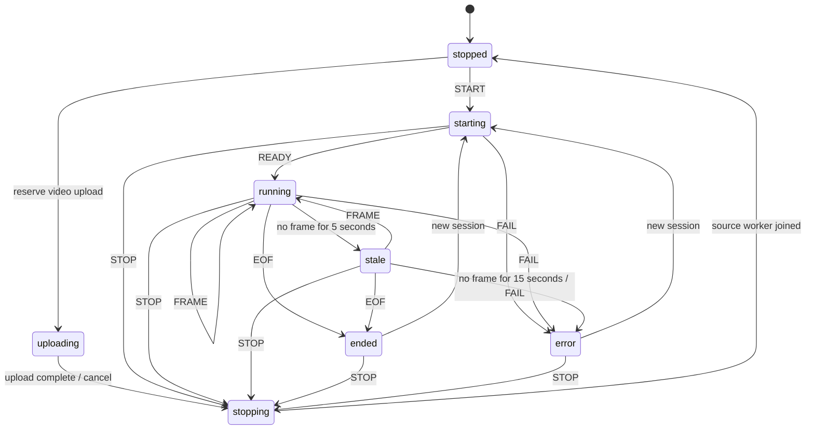
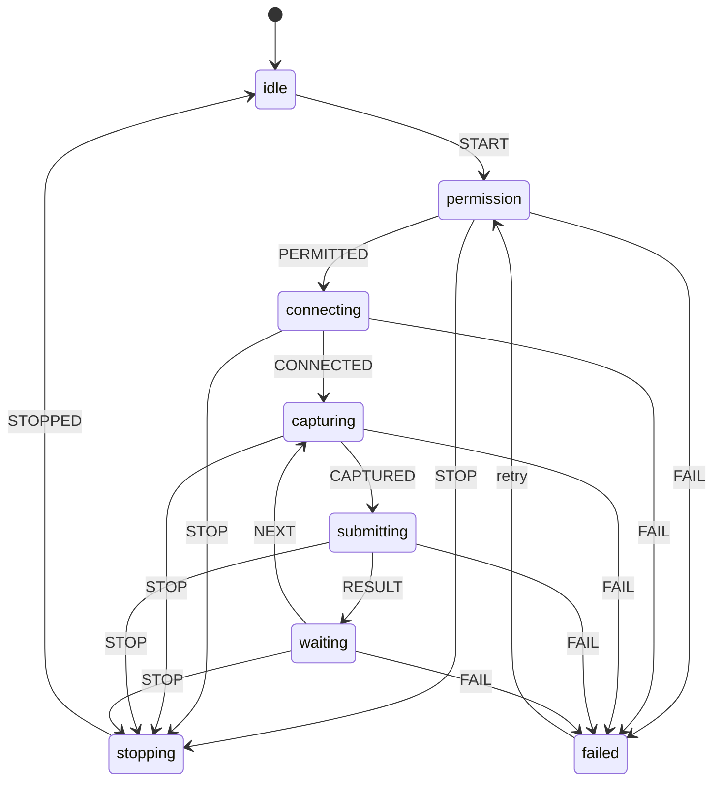
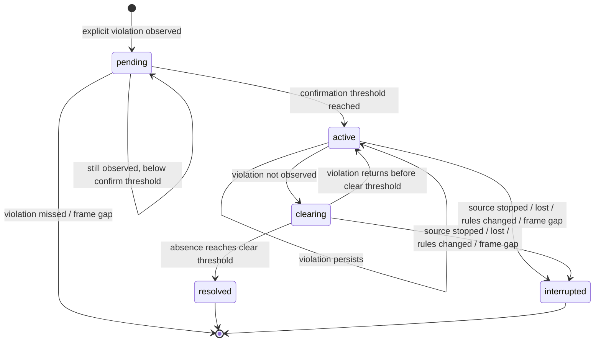

# Machines of state and the frontend/backend boundary

The frontend and backend are independent applications. The frontend owns user interaction, camera permissions, frame capture and rendering. The backend owns inference, tracking, safety rules, temporal confirmation, persistence and delivery. The frontend never declares a safety incident by itself.

## 1. Backend camera machine

Source: `backend/app/services/state_machine.py`. Every lifecycle mutation uses `CameraMachine.dispatch`; unsupported events raise a conflict. `CameraSession.control` serializes start/stop/upload operations, and `CameraSession.lock` serializes processing and protects snapshots.



Completing an upload first stops the reserved upload state, then starts a new video session. A stop is idempotent when already stopped. An active video upload reserves the source; another start/upload cannot silently replace it. Cancelling an upload invalidates its token, so its late completion cannot start a new source.

Each run gets a new `session_id`. The sequence counter starts at one. State version increments on accepted machine events. Backend camera status is authoritative; client transport state describes only browser work.

## 2. Frontend capture machine

Sources: `frontend/src/machines/capture.ts`, `frontend/src/hooks/useBrowserCamera.ts`. State snapshots are immutable and React subscribes through `useSyncExternalStore`.



Only one frame is in flight. A result must belong to the active camera session. A cancellation increments the capture epoch, aborts the outstanding frame request, clears its timer and releases media tracks. Late permission/start completions compare that epoch and clean up their exact session. They cannot update a newer run. Closing the tab releases the camera and sends a scoped stop; if that request fails, the backend watchdog interrupts stale observation.

The command machine (`frontend/src/machines/command.ts`) has `idle → executing → idle/failed`; it rejects concurrent commands and supports explicit error dismissal/retry. API polling ignores outdated responses using request generations. Editable camera settings are separate from live polling so unsaved input does not disappear on refresh.

## 3. Rule and incident machine

Source: `backend/app/services/engine.py`. Key: `(camera session, worker track ID, rule type)`. Every frame uses one monotonic timestamp. Video files use their media timeline; browser/RTSP use monotonic process time.



- A `pending` observation creates no database incident and sends no alert.
- Confirming it creates one `ACTIVE` incident. Repeated frames update its duration/confidence; they do not create more rows or notifications.
- During `clearing`, the same incident remains ACTIVE in storage. The absence interval is measured from the last frame that observed the violation.
- If the violation returns before completion, it resumes the same incident.
- A gap greater than 3 seconds breaks temporal continuity. Pending observations reset; confirmed incidents become INTERRUPTED. The next observation begins confirmation again.
- A stopped/lost camera or server restart cannot prove that a violation cleared: ACTIVE becomes INTERRUPTED.
- RESOLVED and INTERRUPTED are terminal database states. Guarded SQL updates prevent a late operation from reopening or overwriting a terminal incident.
- A later new violation creates a new incident with a new ID.

### Evidence and side effects

An annotated JPEG is written to a temporary file and atomically moved to its final filename **before** the complete incident row is inserted. A failed snapshot does not create an alert or incident row. Database insertion failure removes that orphaned image. The inference loop never calls Telegram directly: it enqueues one bounded delivery job. Delivery status is `disabled / not_configured / pending / sent / failed`; network failures do not stop camera inference and logs omit bot credentials.

## 4. Detection and rule definitions

1. Input: uint8 BGR frame; resize preserves aspect ratio. Each ONNX adapter applies RGB conversion, letterboxing, normalization, output decoding, per-class NMS and removal of padding.
2. Output: `Detection(class_name, confidence, bbox)` with finite confidence in `0..1` and normalized `x1 < x2`, `y1 < y2`. Domain objects reject invalid values. HTTP response models validate the exported contract.
3. People: dedicated COCO person detector. Tracking matches detections one-to-one to recent tracks by IoU ≥0.2. Unseen tracks expire after two seconds. IDs identify tracks, not recognized human identities.
4. PPE: each detection is associated to at most one worker. Helmet region is the upper portion of the person; vest region is the torso. If conflicting positive/negative predictions exist, the higher confidence determines the observed state.
5. Absence: `no_helmet` and `no_vest` are explicit model classes. Simply not detecting equipment yields `unknown`, not an absence incident.
6. Zone: user-drawn non-self-intersecting polygon with 3–30 vertices in `0..1`. The person's bottom-center point determines membership; the boundary counts as inside.
7. A disabled rule creates no new observations. Updating rules interrupts existing confirmation/incidents before the new config is applied.

## 5. Camera API protocol

```text
POST /api/v1/cameras/{id}/start { "kind": "browser" }
  → CameraView including session_id

POST /api/v1/cameras/{id}/frame
  Content-Type: image/jpeg
  X-Session-Id: returned session_id
  Body: JPEG bytes, maximum 5 MB
  → FrameResult including sequence, detections, tracks, rules, FPS, latency and frame_url

GET frame_url
  → Exact raw frame matching session_id + sequence

POST /api/v1/cameras/{id}/stop?session_id=returned-session-id
  → CameraView in stopped state
```

The frontend draws class labels and confidence percentages over that exact inferred frame. A fixed preview surface fits portrait/landscape inputs without changing detection coordinates. Four recent raw/annotated frames are retained in memory for versioned reads; a missing/expired frame returns 404 and another session returns 409.

Backend source alternatives:

- `POST .../video`: binary video up to 200 MB, upload reservation followed by a backend-owned worker.
- `POST .../start {kind: "rtsp", url: "rtsp://..."}`: backend-owned stream worker with open/read timeouts. Private URLs are not persisted.

Invalid input: 400/422. Wrong lifecycle/session: 409. Concurrent frame: 429. Oversized payload: 413. Unknown camera/evidence: 404. Inference/persistence failure changes the camera to ERROR and interrupts its active incidents; the frontend displays an error rather than an empty "safe" result.

## 6. Operational boundaries

One local operator, one backend process, loopback binding. Browser cameras depend on an open tab. CPU throughput is measured, not assumed to equal target FPS. IoU tracking can switch identities in crowded/occluded scenes; model percentages are detection confidence, not calibrated safety probabilities. Physical-camera compatibility and industrial precision/recall need validation on the user's equipment. LinQ plugs into the same Detection contract once its SDK is available.
